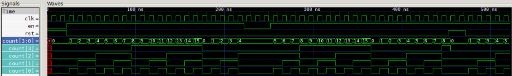

# 4-bit Synchronous Counter (Verilog)

Counter biner 4 bit dengan reset sinkron dan enable, diuji dengan
self-checking testbench dan disimulasikan di Icarus Verilog + GTKWave.

## Cara menjalankan
    iverilog -o sim counter_4bit.v tb_counter_4bit.v
    vvp sim
    gtkwave counter_4bit.vcd

## Hasil
PASS pada semua pengecekan. Gelombang di bawah.

