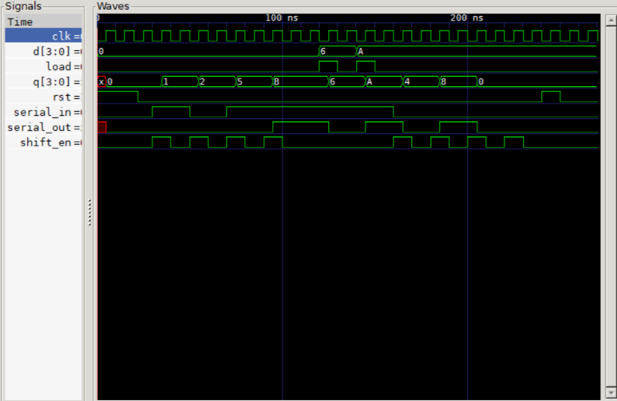

# 4-bit Shift Register (Verilog)

Shift register 4 bit dengan parallel load, mendukung mode SISO, SIPO,
PISO, dan PIPO. Diuji dengan self-checking testbench di Icarus Verilog.

## Cara menjalankan
    iverilog -o sim shift_reg_4bit.v tb_shift_reg_4bit.v
    vvp sim
    gtkwave shift_reg_4bit.vcd

## Hasil
PASS pada pengecekan SIPO, PIPO, PISO, dan RESET.
