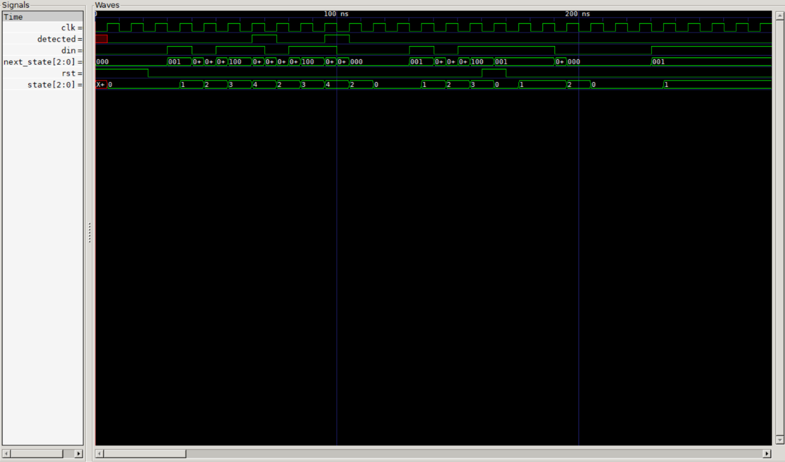

# FSM: 1011 Sequence Detector (Verilog)

Moore FSM yang mendeteksi urutan bit 1011 dengan deteksi tumpang tindih.
Diuji dengan testbench terarah, reset di tengah pola, dan acak
(200 bit) terhadap model acuan.

## Diagram state
S0 -1-> S1, S0 -0-> S0
S1 -1-> S1, S1 -0-> S2
S2 -1-> S3, S2 -0-> S0
S3 -1-> S4, S3 -0-> S2
S4 (detected) -1-> S1, S4 -0-> S2

## Cara menjalankan
    iverilog -o sim seq_detector_1011.v tb_seq_detector_1011.v
    vvp sim
    gtkwave seq_detector_1011.vcd

