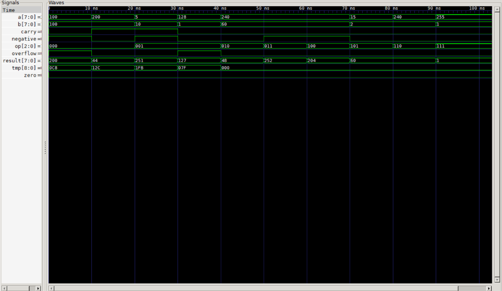

# 8-bit ALU (Verilog)

ALU kombinasional 8 bit: ADD, SUB, AND, OR, XOR, SLL, SRL, SLT, dengan
flag zero, negative, carry/borrow, dan overflow. Diuji secara menyeluruh
(524.288 kombinasi) terhadap model acuan berbasis integer.

## Tabel operasi
| op  | operasi |
| 000 | ADD |
| 001 | SUB |
| 010 | AND |
| 011 | OR  |
| 100 | XOR |
| 101 | SLL |
| 110 | SRL |
| 111 | SLT (bertanda) |

## Cara menjalankan
    iverilog -o sim alu_8bit.v tb_alu_8bit.v
    vvp sim
    gtkwave alu_8bit.vcd

