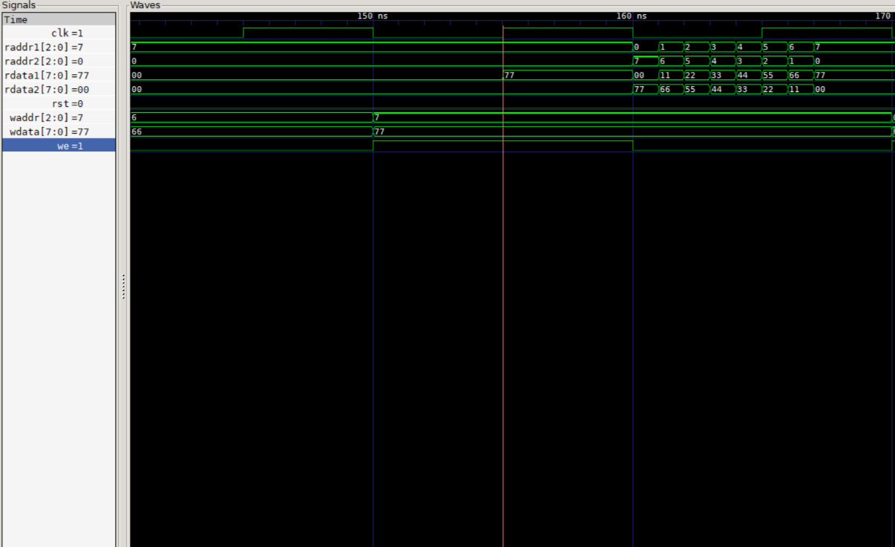

# 8x8 Register File (Verilog)

Register file 8 register x 8 bit, 2 port baca kombinasional, 1 port tulis
sinkron, register 0 terpasang tetap bernilai 0 (seperti x0 di RISC-V).
Diuji dengan model acuan, uji baca-saat-tulis, dan 200 penulisan acak.

## Antarmuka
| sinyal | arah | fungsi |
| we, waddr, wdata | masuk | tulis |
| raddr1, raddr2 | masuk | alamat baca |
| rdata1, rdata2 | keluar | data baca |

## Cara menjalankan
    iverilog -o sim regfile_8x8.v tb_regfile_8x8.v
    vvp sim
    gtkwave regfile_8x8.vcd

