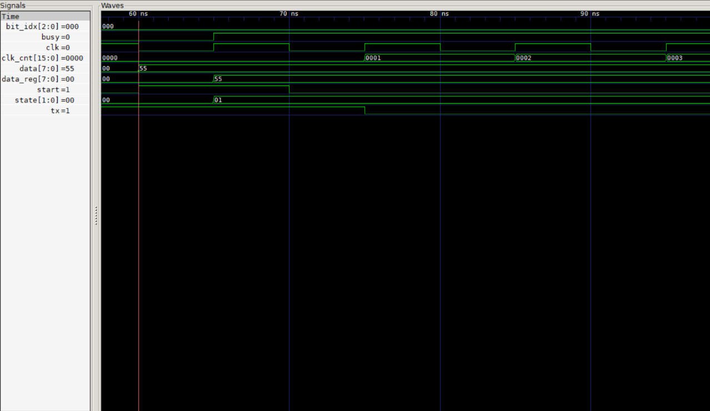

# UART Transmitter (Verilog)

Pengirim UART 8N1 dengan baud rate dari parameter (CLKS_PER_BIT).
Terdiri dari FSM (IDLE, START, DATA, STOP), counter baud, dan pemilih
bit data. Diuji dengan penerima UART tiruan yang mengambil sampel di
tengah bit, untuk byte terarah dan acak.

## Format frame
idle=1 | start=0 | D0..D7 (LSB dulu) | stop=1

## Parameter
CLKS_PER_BIT = clock / baud (contoh: 50 MHz / 115200 = 434)

## Cara menjalankan
    iverilog -o sim uart_tx.v tb_uart_tx.v
    vvp sim
    gtkwave uart_tx.vcd

