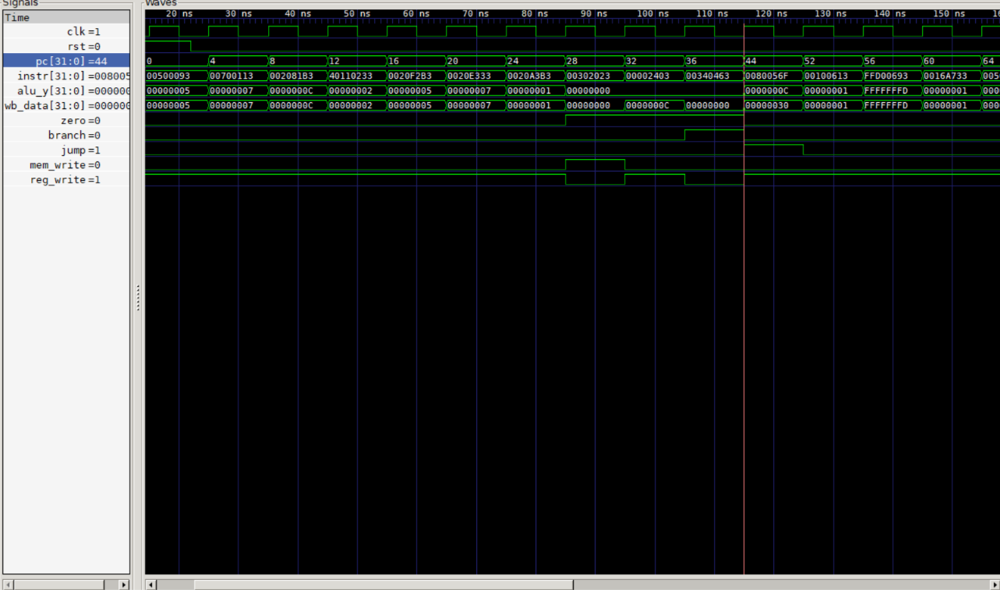

# Tiny RISC-V Single-Cycle CPU (Verilog)

CPU RISC-V RV32I single-cycle dengan 10 instruksi: add, sub, and, or,
slt, addi, lw, sw, beq, jal. Terdiri dari ALU, register file 32x32
(x0 = 0), pembangkit immediate, control unit, memori instruksi, dan
memori data. Diuji dengan program uji yang dirakit lewat fungsi
assembler mini di testbench, dan hasil akhirnya diperiksa otomatis.

## Datapath
PC -> instruction memory -> control + register file + imm gen -> ALU
-> data memory -> write-back; PC berikutnya = PC+4 atau PC+offset.

## Cara menjalankan
    iverilog -g2012 -o sim riscv_single.v tb_riscv_single.v
    vvp sim
    gtkwave riscv_single.vcd

